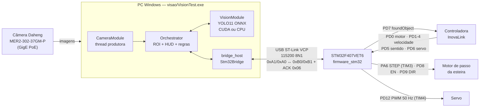

# SICOV — Esteira de Inspeção (Apresentação)

Célula de triagem do projeto **SICOV** (Grupo ASSERT — IFPB). Uma câmera industrial
observa a esteira, uma rede **YOLO11** reconhece formas geométricas e, quando um
**círculo** entra na Zona de Inspeção, o PC avisa o **STM32**. O STM32 repassa o aviso
à controladora **InovaLink**, que para o motor de passo e aciona o servo.

Esta pasta reúne tudo o que roda no PC e no microcontrolador. O código é
compilado **nativamente no Windows**, e o Linux continua suportado.

---

## Sumário

1. [Arquitetura](#1-arquitetura)
2. [Estrutura da pasta](#2-estrutura-da-pasta)
3. [Pré-requisitos (Windows)](#3-pré-requisitos-windows)
4. [Ordem de bring-up](#4-ordem-de-bring-up)
5. [Launcher gráfico (automação)](#5-launcher-gráfico-automação)
6. [Build](#6-build)
7. [Execução](#7-execução)
8. [Protocolo PC ↔ STM32](#8-protocolo-pc--stm32)
9. [Origem do código e alterações](#9-origem-do-código-e-alterações)
10. [Pendências conhecidas](#10-pendências-conhecidas)
11. [Solução de problemas](#11-solução-de-problemas)

---

## 1. Arquitetura



**Ciclo de operação:**

1. O STM32 liga e envia `0xB1`, liberando a varredura no PC.
2. A esteira anda. Se o PC vê um círculo **inteiro** dentro da ROI, envia `0xA1`, e o STM32 coloca `PD7` em 0.
3. A InovaLink lê `PD7 = 0`, para o motor e aciona o servo. Nesse momento o STM32 envia `0xB0` e o PC **pausa a detecção**.
4. Quando o servo termina e o motor volta a girar, o STM32 envia `0xB1` e o PC volta a detectar.
5. Ao ser pausado, o PC também envia `0xA0`, que devolve `PD7` para 1 e prepara o próximo ciclo.

---

## 2. Estrutura da pasta

```text
Apresentação Esteira/
├── CMakeLists.txt         # Projeto de topo (bridge + visão)
├── CMakePresets.json      # Presets: windows, windows-bridge, linux
├── visao/                 # Aplicação de visão (PC)
│   ├── CMakeLists.txt
│   ├── inc/  src/         # CameraModule, VisionModule, Orchestrator, main
│   └── models/            # yolo11_formas.onnx (fora do Git, ver §3)
├── bridge_host/           # Biblioteca serial PC ↔ STM32 (Windows + Linux)
│   ├── include/  src/
│   └── example/           # bridge_example (terminal de teste) e serial_example
├── firmware_stm32/        # Projeto STM32CubeIDE (STM32F407VET6)
│   └── README.md          # Pinagem, timers e detalhes do firmware
└── tools/                 # Launcher gráfico PySide6 (ver §5)
    ├── sicov-launcher.sh  # Entrada no Linux
    ├── requirements.txt
    └── sicov_launcher/
```

---

## 3. Pré-requisitos (Windows)

| Componente | Versão testada / sugerida | Observação |
| :--- | :--- | :--- |
| Visual Studio 2022 Build Tools | carga "Desenvolvimento para desktop com C++" | Já traz o CMake ≥ 3.21 |
| OpenCV para Windows | 4.10 ou mais nova (`opencv-4.x-windows.exe`) | Extraia, por exemplo, em `C:\opencv` e defina `OpenCV_DIR=C:\opencv\build` |
| Galaxy SDK (Daheng) para Windows | versão atual do site da Daheng | Instala o `GxIAPI.h`/`GxIAPI.lib`, o driver GigE e o *GxGigeIPConfig* |
| STM32CubeIDE | 2.x (já instalado) | Inclui o driver do ST-Link e o VCP |
| Modelo ONNX | `yolo11_formas.onnx` | Fica fora do Git. Copie para `visao/models/` (há uma cópia em `../Vision_Geometrica (Cópia).zip`) |

> **OpenCV com CUDA:** o pacote pronto do OpenCV para Windows **não tem CUDA**.
> Com ele, a inferência roda em CPU e o log mostra `Inferencia em CPU`.
> Para usar a RTX 4050 é preciso compilar o OpenCV com `WITH_CUDA=ON` e
> `OPENCV_DNN_CUDA=ON`. Isso não muda nada neste projeto, basta apontar o `OpenCV_DIR` para o novo build.

**Rede da câmera GigE:** a placa de rede ligada ao switch PoE precisa estar na
mesma sub-rede da câmera. Use o *GxGigeIPConfig* do Galaxy SDK para ver e
ajustar o IP da câmera. O firewall do Windows precisa liberar o *GalaxyView*
e o `VisionTest.exe` na rede privada.

---

## 4. Ordem de bring-up

Suba o sistema uma camada por vez. Assim, cada problema aparece isolado.

1. **Firmware:** no launcher, clique em **Gravar no STM32**. Ele compila e grava pelo ST-Link. Outra opção é abrir `firmware_stm32/` no STM32CubeIDE (*File → Import → Existing Projects*), compilar e gravar por lá.
2. **Comunicação:** compile o preset `windows-bridge` e rode o `bridge_example`. Ao resetar o STM32, deve aparecer `ResumeScan (0xB1)`. Os comandos `1` e `0` precisam receber ACK.
3. **Câmera:** confirme no *GalaxyView* que a câmera aparece e transmite imagem.
4. **Visão completa:** compile o preset `windows` e rode o `VisionTest`.
5. **Integração com a InovaLink:** com a esteira em movimento, confirme o ciclo completo descrito na §1.

---

## 5. Launcher gráfico (automação)

O `tools/sicov_launcher` é uma interface em **PySide6** que automatiza tudo o que
este README descreve, tanto no Linux quanto no Windows: verificar e instalar dependências,
compilar, rodar a visão, abrir o terminal da bridge, testar o handshake com o STM32 e
**compilar e gravar o firmware do STM32**.

**Linux** (de dentro de `Apresentação Esteira/`):

```bash
sh tools/sicov-launcher.sh
```

**Windows:**

```powershell
python tools\sicov_launcher
```

**Na primeira execução**, o launcher instala sozinho o que precisa:

| O que falta | Como é instalado |
| :--- | :--- |
| `python3` (Linux) | O `sicov-launcher.sh` pergunta e instala via apt, dnf ou pacman |
| PySide6 | Fica num ambiente virtual em `tools/.venv`, criado automaticamente. No Ubuntu/Debian, se faltar o `python3-venv`, ele pergunta antes de instalar |
| `libxcb-cursor0` (exigida pelo Qt 6.5+ no X11) | Pergunta antes de instalar |

**Pela janela**, o botão **Instalar dependências** cuida do resto:
- **CMake ≥ 3.21:** instalado via pip no venv, sem sudo, o que funciona até em distros com CMake antigo.
- **Compilador e OpenCV:** pacotes `build-essential`, `pkg-config` e `libopencv-dev`, ou os equivalentes no dnf e no pacman. O launcher pede a senha de administrador pela janela do sistema (`pkexec`).
- **Grupo `dialout`:** o launcher adiciona o seu usuário. A permissão só vale depois de sair da sessão e entrar de novo.
- **Firmware:** `gcc-arm-none-eabi` e `libnewlib-arm-none-eabi` para compilar, e `stlink-tools` para gravar. O `stlink-tools` também instala as regras udev que liberam o ST-Link sem root (reconecte o USB depois). O Ninja vem via pip.

Se o STM32CubeIDE ou o STM32CubeProgrammer estiverem instalados (`/opt/st/...` no Linux, `C:\ST\...` no Windows),
o launcher usa o compilador ARM, o Ninja, o CMake e o `STM32_Programmer_CLI` deles e não instala nada.

Antes de executar, uma janela de confirmação mostra exatamente o que vai ser feito.
O **Galaxy SDK** é proprietário e não tem pacote: o launcher verifica se ele existe e indica onde baixar.

| Botão | O que faz |
| :--- | :--- |
| Verificar ambiente | CMake, compilador, OpenCV, Galaxy SDK, modelo, porta serial e grupo dialout, com a solução de cada item pendente |
| Extrair modelo do zip | Copia o `yolo11_formas.onnx` de `../Vision_Geometrica (Cópia).zip` para `visao/models/` |
| Compilar tudo / só a bridge | `cmake --preset ...` seguido de `cmake --build`, com os caminhos preenchidos na tela |
| Rodar visão | Executa o `VisionTest` a partir de `visao/`, com `--model`, `--camera-sn` e `--port` |
| Terminal da bridge | Abre o `bridge_example`. A caixa de texto embaixo do log envia comandos (`1`, `0`, `v`, `s`, `q`) |
| Testar handshake com o STM32 | Envia `0xA1` e `0xA0` automaticamente e só dá sucesso se os dois receberem ACK |
| Fluxo completo | Verificar, instalar o que faltar, compilar tudo e testar o STM32, em sequência. Para no primeiro erro |
| Compilar firmware | Compila `firmware_stm32/` para ARM (`cmake --preset firmware`) e gera `build/comEdge.elf`, `.bin` e `.hex` |
| Gravar no STM32 | Compila e grava pelo ST-Link (SWD), verifica e reseta a placa. Usa o primeiro gravador que encontrar: STM32CubeProgrammer, `st-flash` ou OpenOCD |

As configurações (caminhos, porta e SN da câmera) ficam salvas entre execuções.

---

## 6. Build

Use um terminal **"Developer PowerShell for VS 2022"**, na raiz desta pasta:

```powershell
$env:OpenCV_DIR = "C:\opencv\build"          # onde está o OpenCVConfig.cmake
cmake --preset windows
cmake --build --preset windows
```

Para compilar **só a bridge**, sem precisar de OpenCV nem de câmera:

```powershell
cmake --preset windows-bridge
cmake --build --preset windows-bridge
```

Se o Galaxy SDK não estiver no caminho padrão
(`C:\Program Files\Daheng Imaging\GalaxySDK\Development\VC SDK`), informe a pasta:

```powershell
cmake --preset windows -DGALAXY_SDK_DIR="D:/Daheng/GalaxySDK/Development/VC SDK"
```

No Linux, use `cmake --preset linux` e depois `cmake --build --preset linux`.

---

## 7. Execução

O `VisionTest` procura `models/` e grava `roi_config.yml` **na pasta de execução**.
Por isso, rode o programa de dentro de `visao/`:

```powershell
cd visao
..\build\windows\visao\Release\VisionTest.exe --port COM5
```

| Opção | Padrão | Descrição |
| :--- | :--- | :--- |
| `--model <arquivo>` | `models/yolo11_formas.onnx` | Modelo ONNX |
| `--camera-sn <SN>` | `FBR26040067` | Câmera da esteira. Com `--camera-sn ""`, usa a primeira encontrada |
| `--port <COMx>` | auto-detecção | Porta do STM32. Também aceita a variável de ambiente `SERIAL_PORT` |

Para descobrir a porta, abra o *Gerenciador de Dispositivos → Portas (COM e LPT) →
"STMicroelectronics STLink Virtual COM Port (COMx)"*. Outra forma é rodar o `bridge_example`
e usar o comando `s`.

**Teclas:**
- `s` salva a calibração da ROI;
- `ESC` encerra.

As trackbars ajustam a ROI ao vivo.

> **Inicie o `VisionTest` antes de ligar ou resetar o STM32.** O firmware só envia
> o `0xB1` inicial no boot (ver §10). Se o PC abrir depois, a tela fica em
> `PAUSADO PELO STM32` até você apertar RESET na placa.

Terminal de teste da bridge:

```powershell
.\build\windows\bridge_host\Release\bridge_example.exe COM5
```

---

## 8. Protocolo PC ↔ STM32

| Byte | Sentido | Significado |
| :---: | :---: | :--- |
| `0xA1` | PC → STM32 | Círculo na ROI. O STM32 coloca `PD7 = 0` |
| `0xA0` | PC → STM32 | Sem objeto. O STM32 coloca `PD7 = 1` |
| `0xB0` | STM32 → PC | Pausar a varredura (motor parado e servo ativo) |
| `0xB1` | STM32 → PC | Liberar a varredura (boot, ou motor ativo e servo inativo) |
| `0x06` | ambos | ACK. O PC tenta até 3 vezes com timeout de 500 ms. O STM32 espera 50 ms |

A pinagem completa e os detalhes dos timers estão em [`firmware_stm32/README.md`](firmware_stm32/README.md).

---

## 9. Origem do código e alterações

| Pasta | Origem |
| :--- | :--- |
| `visao/` | `IA_Vision`, versão de `src/JDJDJD.cpp` (Orchestrator com STM32) |
| `bridge_host/` | [stm32-uart-host-bridge](https://github.com/EduardSilva774/stm32-uart-host-bridge) `host/` @ `5177b90` |
| `firmware_stm32/` | mesmo repositório, `firmware/` @ `5177b90` (alterado só o servo, ver abaixo) |

**Alterações na bridge:**
- **Backend Win32 em `SerialPort`:** usa `CreateFile`, `DCB`, `COMMTIMEOUTS` e I/O overlapped, o que permite ler e escrever ao mesmo tempo (o ACK sai da thread de RX).
- **`AsyncSerialReceiver`:** no Windows, troca o `poll()` por uma leitura com timeout de 100 ms.
- **`PortEnumerator`:** no Windows, enumera as portas pelo SetupAPI, com VID/PID, nome amigável em UTF-8 e porta COM.
- **Linux:** o código POSIX original foi mantido intacto, atrás de `#ifdef`.
- **CMake:** a opção `BRIDGE_BUILD_EXAMPLES` fica desligada quando a bridge é usada como subdiretório. Também foram adicionados o alias `stm32_bridge::serial_lib` e os warnings `/W4` e `-Wall -Wextra`.
- **`bridge_example`:** passa a ter UTF-8 e cores ANSI no console do Windows.

**Alterações no firmware:**
- **Servo:** começa e repousa em **1650 µs** e vai até **600 µs** quando a InovaLink aciona o servo (PD6 = 1). As constantes `SERVO_PULSE_REST_US` e `SERVO_PULSE_WORK_US` substituem `IDLE`/`ACTIVE`, que estavam com o sentido trocado em `BSP_StartServo`/`BSP_StopServo`.

**Alterações na visão, em relação ao JDJDJD:**
- **Linha de comando:** `--model`, `--camera-sn` e `--port` substituem os valores fixos no código.
- **Quadro limpo para a IA:** agora a IA recebe o quadro **sem** o desenho da ROI. No JDJDJD, a moldura amarela era desenhada antes do `Vision_SubmitFrame`.
- **CUDA:** a `VisionModule` verifica se a CUDA existe antes de usá-la. Sem isso, o log dizia "CUDA inicializado" mesmo rodando em CPU.
- **Falha na conexão:** se o STM32 não conectar na inicialização, a câmera é liberada.
- **Limpeza:**
  - a função `ObterNomeForma`, que não era usada, foi removida;
  - o desenho de caixa duplicado virou `DesenharDeteccao()`;
  - o comentário de exposição foi corrigido (30 ms);
  - `nDevNum <= 0` virou `== 0`;
  - a `VisionModule.hpp` ganhou documentação.
- **CMake:**
  - o Galaxy SDK passa a ser configurável, em vez de um caminho absoluto de `/home/iona50`;
  - a bridge é integrada via `add_subdirectory`;
  - as DLLs do OpenCV são copiadas para junto do `.exe`;
  - o *working directory* do Visual Studio aponta para `visao/`.

---

## 10. Pendências conhecidas

Estes pontos ficam documentados em vez de alterados, porque mudam o comportamento
da esteira e precisam ser validados na bancada:

1. **`0xB1` só no boot.** A bridge começa com a varredura **pausada**. Se o PC conectar depois do boot do STM32, perde o `0xB1`. Duas correções possíveis: o firmware reenviar o estado periodicamente, ou responder a um comando de consulta.
2. **A pausa depende do servo.** O STM32 só envia `0xB0` com o motor parado **e** o servo ativo, e só envia `0xB1` com o motor ativo **e** o servo inativo. A regra desejada é "motor ligado = pode detectar". Se a InovaLink parar o motor sem acionar o servo, a visão não pausa.
3. **O firmware não bate com a documentação.** O README do firmware diz `PD0 = 0` para motor ativo e `PD5 = 1` para a direita, mas o `bsp.c` faz o contrário. Confirme com a InovaLink qual lado está certo.
4. **Janela entre o `0xA1` e o `0xB0`.** Depois de enviar `0xA1`, o PC continua detectando até a InovaLink reagir.
5. **Memória da bridge.** O `MessageBufferObserver` interno da bridge guarda todo byte recebido e nunca é esvaziado após a conexão. Como o volume é de poucos bytes por ciclo, não é crítico, mas deve ser limpo em uso contínuo.

---

## 11. Solução de problemas

| Sintoma | Causa provável | O que fazer |
| :--- | :--- | :--- |
| `Nenhuma camera Daheng encontrada` | Câmera em outra sub-rede ou bloqueada pelo firewall | Use o *GxGigeIPConfig* para colocar câmera e placa de rede na mesma sub-rede e libere o app no firewall |
| `Falha ao abrir porta serial: COMx` | Porta aberta em outro programa (CubeIDE, monitor serial) | Feche o terminal serial ou a sessão de debug do CubeIDE |
| `Nenhum microcontrolador STM32 detectado` | ST-Link com outro PID ou adaptador USB-TTL | Passe `--port COMx` |
| Tela parada em `PAUSADO PELO STM32` | O `0xB1` do boot chegou antes do PC conectar | Aperte RESET no STM32 com o `VisionTest` aberto |
| `Timeout aguardando ACK` | Firmware não gravado, baud diferente ou VCP sem ligação com PA9/PA10 | Teste com o `bridge_example` e confira a ligação da USART1 com o ST-Link |
| Build do firmware no CubeIDE falha com "No such file" | Caminho com espaço ou acento ("Apresentação Esteira") | Use o botão **Gravar no STM32** do launcher, que aceita esse caminho, ou copie `firmware_stm32/` para um caminho sem espaços |
| `No debug probe detected` ao gravar | ST-Link desconectado, sem permissão USB ou ocupado | Reconecte o ST-Link, feche o debug do CubeIDE e, no Linux, reconecte depois de instalar o `stlink-tools` |
| `opencv_world*.dll não encontrada` | DLL fora do PATH | Recompile (o pós-build copia a DLL) ou adicione `C:\opencv\build\x64\vc16\bin` ao PATH |
